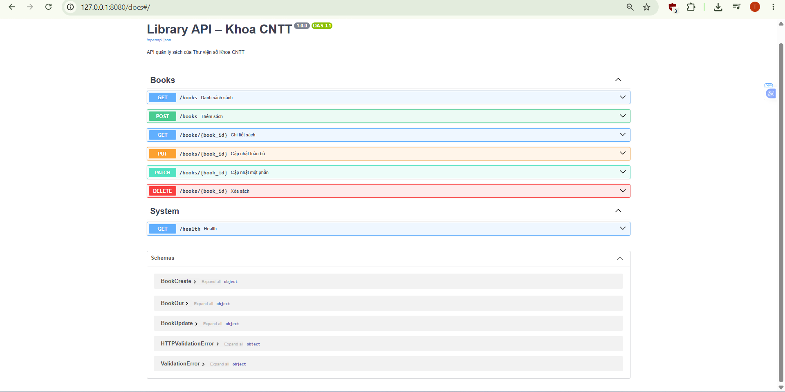
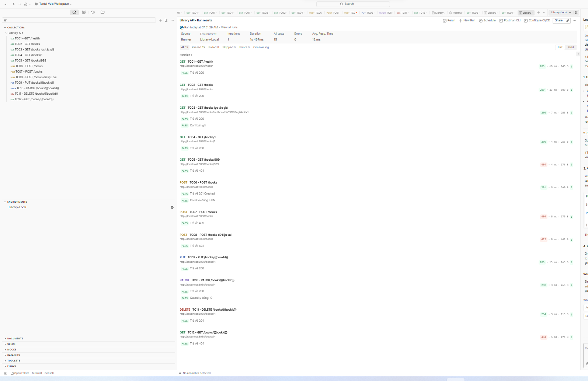

# Books API

Library API – Khoa CNTT: RESTful API quản lý sách (CRUD) viết bằng Python (FastAPI), kèm tài liệu Swagger và bộ kiểm thử Postman.

## 1. Mô tả case study

Một thư viện nhỏ cần một dịch vụ backend để quản lý danh mục sách. API cho phép:

- Xem danh sách và chi tiết sách
- Thêm sách mới
- Cập nhật toàn bộ (PUT) hoặc một phần (PATCH) thông tin sách
- Xóa sách

## 2. Cấu trúc dự án

```
lab4_manguonmo/
├── app/
│   ├── main.py          # Khởi tạo ứng dụng
│   ├── models.py        # Mô hình dữ liệu
│   ├── data.py          # Dữ liệu mẫu
│   └── routers/
│       └── books.py     # Các endpoint /books
├── postman/             # Collection và environment
├── docs/                # Ảnh minh họa
└── requirements.txt
```

## 3. Cài đặt và chạy

Yêu cầu: Python >= 3.10, Git.

```bash
git clone <repo-url>
cd lab4_manguonmo
git checkout feature/books-api

python -m venv .venv
.venv\Scripts\activate          # Windows
# source .venv/bin/activate     # macOS/Linux

pip install -r requirements.txt
uvicorn app.main:app --reload --port 8080
```

Server chạy tại `http://127.0.0.1:8080` (có thể đổi cổng bằng `--port`).
Tài liệu Swagger: `http://127.0.0.1:8080/docs`.

## 4. Bảng endpoint (Bảng 2)

| Method | Endpoint | Mô tả | Mã trả về |
|--------|----------|-------|-----------|
| GET | `/books` | Lấy danh sách sách | 200 |
| GET | `/books/{book_id}` | Lấy chi tiết một cuốn sách | 200, 404 |
| POST | `/books` | Thêm sách mới | 201, 422 |
| PUT | `/books/{book_id}` | Cập nhật toàn bộ sách | 200, 404, 422 |
| PATCH | `/books/{book_id}` | Cập nhật một phần thông tin | 200, 404, 422 |
| DELETE | `/books/{book_id}` | Xóa sách | 204, 404 |
| GET | `/health` | Kiểm tra tình trạng server | 200 |

## 5. Cách chạy kiểm thử

1. Khởi động server: `uvicorn app.main:app --reload`
2. Mở Postman, chọn **Import** và nạp hai file trong thư mục `postman/`:
   - `Library API.postman_collection.json`
   - `Library-Local.postman_environment.json`
3. Chọn environment **Library-Local**.
4. Mở **Collection Runner**, chọn collection và nhấn **Run**.
5. Kết quả mong đợi: toàn bộ test pass.

## 6. Ảnh minh họa

**Swagger UI**



**Postman Runner**



## 7. Quy ước commit

Dự án dùng [Conventional Commits](https://www.conventionalcommits.org/):

- `feat:` thêm tính năng (ví dụ `feat: add PATCH endpoint`)
- `test:` thêm hoặc sửa kiểm thử (ví dụ `test: add postman collection`)
- `docs:` cập nhật tài liệu (ví dụ `docs: update README`)